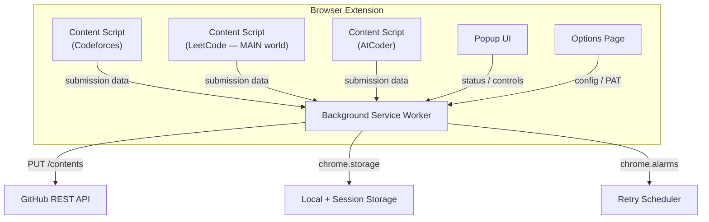

# CodeHub — Competitive Programming Submission Syncer

A Chrome/Edge browser extension (Manifest V3) that automatically detects accepted submissions on **Codeforces**, **LeetCode**, and **AtCoder**, then pushes them to a user-configured GitHub repository with clean folder organization and rich metadata.

## Design Decisions (Finalized)

| Decision | Choice | Rationale |
|----------|--------|-----------|
| **Auth Model** | Personal Access Token (PAT) | No server needed; user pastes a fine-grained token with `contents:write` scope. OAuth can be added in v2. |
| **Repo Structure** | Platform → Problem → solution files + README | Clean, browsable hierarchy |
| **LeetCode Strategy** | Network interception (GraphQL) via main-world content script | Most reliable given React/Cloudflare; requires `"world": "MAIN"` content script injection to bypass CSP and intercept `fetch` in the page context |

| **Multi-Language** | Store ALL language variants | Same problem folder holds `solution.cpp`, `solution.py`, etc. |
| **Repo Creation** | User creates repo manually | Extension only writes to an existing repo selected in settings |
| **Browser Target** | Chrome + Edge (Chromium) | Manifest V3, can extend to Firefox later |
| **Queue Persistence** | `chrome.storage.local` | Service workers are ephemeral in MV3; all queue state must survive restarts |
| **PAT Storage** | Encrypted in `chrome.storage.local`, decrypted copy in `chrome.storage.session` | Session storage is cleared when browser closes; local storage persists the encrypted version |

### Directory Structure (with multi-language)
```
repo/
├── codeforces/
│   └── 1900A-Cover-in-Water/
│       ├── solution.cpp
│       ├── solution.py          ← if solved in multiple languages
│       └── README.md
├── leetcode/
│   └── 0001-Two-Sum/
│       ├── solution.py
│       ├── solution.java
│       └── README.md
└── atcoder/
    └── abc350-A-Past-ABCs/
        ├── solution.cpp
        └── README.md
```

---

## Architecture Overview



---

## Proposed Changes

### 1. Project Foundation & Configuration

#### [NEW] [manifest.json](file:///d:/Github/codehub/extension/manifest.json)
Chrome Manifest V3 configuration:
- **Permissions**: `storage`, `activeTab`, `notifications`, `alarms`, `webNavigation`
- **Host permissions**: `https://codeforces.com/*`, `https://leetcode.com/*`, `https://atcoder.jp/*`, `https://api.github.com/*`
- **Content scripts**:
  - Codeforces & AtCoder: standard isolated-world content scripts injected on matching URLs
  - LeetCode: content script declared with `"world": "MAIN"` to run in the page's JavaScript context (required for `fetch`/`XMLHttpRequest` interception past CSP)
- **Background**: Service worker (`background.js`) — must handle ephemeral lifecycle (see §2)
- **Action**: Popup (`popup.html`)
- **Options page**: `options.html`
- **Icons**: Extension icons (16, 48, 128px)
- **Commands**: `Ctrl+Shift+S` keyboard shortcut for manual sync trigger

> **Note on `webNavigation`**: Used to detect SPA client-side navigations on LeetCode (which uses `history.pushState`). The background listens to `chrome.webNavigation.onHistoryStateUpdated` and programmatically injects or messages content scripts when the URL changes, ensuring detection works even without a full page reload.

#### [NEW] [package.json](file:///d:/Github/codehub/extension/package.json)
Development dependencies only (no bundler needed initially — pure vanilla JS):
- ESLint for code quality
- Web-ext for testing/packaging

#### [NEW] [.gitignore](file:///d:/Github/codehub/extension/.gitignore)
Excludes `node_modules/`, `web-ext-artifacts/`, `.env`, and any build output.

---

### 2. Background Service Worker (The Brain)

#### [NEW] [background.js](file:///d:/Github/codehub/extension/background.js)
Central orchestrator that:
- Listens for messages from content scripts via `chrome.runtime.onMessage`
- Manages the **persistent push queue** (see Queue & Retry below)
- Handles commit message generation
- Manages notification display (success/failure toasts)
- Tracks sync history in `chrome.storage.local`

- Listens to `chrome.webNavigation.onHistoryStateUpdated` for SPA navigation detection on LeetCode

Key message types:
| Message | Payload | Action |
|---------|---------|--------|
| `SUBMISSION_DETECTED` | `{platform, problem, code, language, verdict}` | Queue GitHub push |

| `GET_STATUS` | — | Return sync stats |
| `GET_CONFIG` | — | Return stored settings |
| `RETRY_PENDING` | — | Process any pending items in the queue |

#### Service Worker Lifecycle (MV3 Constraint)

> **Critical**: Manifest V3 service workers are **ephemeral** — Chrome may terminate them after ~30 seconds of inactivity. This has the following implications:
>
> 1. **No in-memory state**: All queue data, pending submissions, and retry counters must be persisted to `chrome.storage.local` before every operation.
> 2. **No `setTimeout`/`setInterval`**: Use `chrome.alarms` for all scheduled/recurring work (retry timers, periodic checks).
> 3. **Wake-up recovery**: On every service worker activation, immediately check `chrome.storage.local` for pending queue items and resume processing.


---

### 3. GitHub Integration Module

#### [NEW] [github.js](file:///d:/Github/codehub/extension/github.js)
Encapsulates all GitHub REST API interactions:

- **`getFile(path)`** — `GET /repos/{owner}/{repo}/contents/{path}` to retrieve current SHA (needed for updates)
- **`createOrUpdateFile(path, content, message)`** — `PUT /repos/{owner}/{repo}/contents/{path}` with Base64-encoded content
- **`pushSubmission(submission)`** — High-level method that:
  1. Generates the file path using language extension (e.g., `codeforces/1900A-Cover-in-Water/solution.cpp`)
  2. If same problem solved in another language, the new file sits alongside existing ones (`solution.py` next to `solution.cpp`)
  3. Generates/updates README.md with problem metadata — fetches existing README, parses the solutions table, appends the new language row, then pushes the updated version (see §README Format below)
  4. Checks if file exists (gets SHA if so — update only if code changed)
  5. Pushes files with a descriptive commit message

- **`validateToken()`** — `GET /user` to verify PAT is valid
- **`listRepos()`** — `GET /user/repos` for repo selector in options

All requests include:
```
Authorization: Bearer <PAT>
Accept: application/vnd.github+json
X-GitHub-Api-Version: 2022-11-28
```

#### Rate Limiting & Throttling

GitHub's REST API allows **5,000 requests/hour** for authenticated users. The module implements:

- **Sequential queue** with concurrency of 1 (prevents race conditions on SHA updates)
- **Rate limit header tracking**: Read `X-RateLimit-Remaining` and `X-RateLimit-Reset` from every response
- **Proactive throttling**: If remaining requests < 100, slow down; if < 10, pause until reset
- **Exponential backoff**: On `403` (rate limit) or `429` (too many requests), retry after `2^attempt` seconds (max 3 retries, max 60s delay)
- **SHA conflict resolution**: On `409 Conflict`, re-fetch the file SHA and retry the push

#### README Format (Multi-Language)

When a problem folder has solutions in multiple languages, the README uses a solutions table:

```markdown
# Two Sum

| Platform | Difficulty | Tags |
|----------|------------|------|
| LeetCode | Easy | Array, Hash Table |

[Problem Link](https://leetcode.com/problems/two-sum/)

## Solutions

| # | Language | Runtime | Memory | Date |
|---|----------|---------|--------|------|
| 1 | Python 3 | 48ms (95.2%) | 15.2 MB | 2026-08-09 |
| 2 | Java | 2ms (99.1%) | 42.1 MB | 2026-08-10 |
```

The `generateReadme` function in `utils.js`:
1. On first submission: creates the full README with a single-row solutions table
2. On subsequent submissions (new language): fetches existing README from GitHub, parses the Markdown solutions table, appends a new row, and pushes the updated README
3. On re-submission (same language): updates the existing row with new runtime/memory stats and date

---

### 4. Error Handling & Retry Strategy

> This is a **core concern**, not a bonus feature.

#### Error Categories & Responses

| Error | Detection | Response |
|-------|-----------|----------|
| **Network failure** | `fetch` throws / `navigator.onLine === false` | Queue locally, set `chrome.alarms` retry in 60s |
| **GitHub rate limit** | `403` / `429` response | Exponential backoff, pause queue, notify user |
| **SHA conflict** | `409 Conflict` | Re-fetch SHA, retry push (max 3 attempts) |
| **Invalid PAT** | `401 Unauthorized` | Mark connection as broken, notify user, pause all syncs |
| **Repo not found** | `404` on push | Notify user to check repo settings |
| **Service worker killed** | Worker restarts with pending queue items | Resume queue on activation via `chrome.storage.local` |

#### Queue Persistence

```
chrome.storage.local = {
  pushQueue: [
    { id, submission, status: 'pending'|'retrying'|'failed', attempts: 0, lastError, createdAt },
    ...
  ],

}
```

- Every queue mutation is **written to storage before the operation starts**
- On service worker wake-up: load queue, process items with `status !== 'failed'`
- Items with `attempts >= 3` are marked `'failed'` and surfaced in the popup UI with a manual retry button
- `chrome.alarms.create('retryPending', { delayInMinutes: 1 })` schedules retry checks

#### Offline Support

- Check `navigator.onLine` before every push attempt
- Listen for the `online` event to trigger queue processing when connectivity is restored
- All detected submissions are queued regardless of connectivity — they'll sync when online

---

### 5. Content Scripts (Platform Scrapers)

Each content script detects an "Accepted" verdict and extracts the submission data.

#### [NEW] [content-codeforces.js](file:///d:/Github/codehub/extension/content-codeforces.js)
**Strategy**: Hybrid — use Codeforces API for metadata + DOM scraping for source code.

- **Detection**: Runs on the following URL patterns:
  - `https://codeforces.com/contest/*/submission/*` (regular contests)
  - `https://codeforces.com/problemset/submission/*/*` (problemset)
  - `https://codeforces.com/gym/*/submission/*` (gym contests)
  - `https://codeforces.com/group/*/contest/*/submission/*` (group contests)
- **Code extraction**: `document.querySelector('pre#program-source-text')?.innerText`
- **Metadata**: Parse from DOM — problem name, contest ID, language, verdict, runtime, memory
- **Trigger**: Auto-detect on page load when verdict is "Accepted", or via MutationObserver for dynamic loading
- **Sends**: `{platform: 'codeforces', problemId, problemName, contestId, code, language, runtime, memory, url}`

> **Scope note (v1)**: `m.codeforces.com` (mobile site) is out of scope. Can be added in v2.

#### [NEW] [content-leetcode.js](file:///d:/Github/codehub/extension/content-leetcode.js)
**Strategy**: Network interception via **main-world injection** — hook into `fetch`/`XMLHttpRequest` in the page's JavaScript context to capture GraphQL responses.

> **Why main-world?** LeetCode has a strict Content Security Policy. Content scripts normally run in an isolated world and cannot intercept the page's network calls. By declaring `"world": "MAIN"` in `manifest.json`, the script runs in the page's context and can monkey-patch `window.fetch` and `XMLHttpRequest.prototype.open`/`send` before LeetCode's code executes.
>
> **Security trade-off**: Main-world scripts share the page's JavaScript context, meaning the page could theoretically detect or interfere with the extension. This is an accepted trade-off for v1 since the alternative (parsing the DOM after React renders) is fragile and misses submission details.

- **Detection**: Runs on `https://leetcode.com/problems/*`
- **SPA handling**: Background script listens for `chrome.webNavigation.onHistoryStateUpdated` on `leetcode.com` and re-injects or signals the content script when the user navigates between problems without a full page reload
- **Code extraction**: Intercept the GraphQL response for `submissionDetails` query, which contains the submitted code and verdict
- **Metadata**: Problem title, difficulty, tags, acceptance rate, runtime percentile
- **Trigger**: When a submission response with `statusDisplay: "Accepted"` is intercepted
- **Communication**: Since main-world scripts can't use `chrome.runtime.sendMessage`, the script posts data via `window.postMessage`. A companion isolated-world content script listens for these messages and relays them to the background via `chrome.runtime.sendMessage`.
- **Fallback**: DOM scraping of the submission success panel as backup
- **Sends**: `{platform: 'leetcode', problemId, problemName, difficulty, tags[], code, language, runtime, memory, url}`

#### [NEW] [content-leetcode-bridge.js](file:///d:/Github/codehub/extension/content-leetcode-bridge.js)
**Purpose**: Isolated-world companion script that bridges communication between the main-world LeetCode script and the background service worker.
- Listens for `window.postMessage` events from `content-leetcode.js`
- Validates message origin and structure
- Forwards submission data to background via `chrome.runtime.sendMessage`

#### [NEW] [content-atcoder.js](file:///d:/Github/codehub/extension/content-atcoder.js)
**Strategy**: DOM scraping on submission detail page.

- **Detection**: Runs on `https://atcoder.jp/contests/*/submissions/*`
- **Code extraction**: `document.querySelector('#submission-code')?.innerText`
- **Metadata**: Contest ID, problem ID, task name, language, verdict, execution time
- **Trigger**: Auto-detect on page load when verdict table shows "AC"
- **Sends**: `{platform: 'atcoder', problemId, problemName, contestId, code, language, runtime, memory, url}`

---


### 6. Popup UI (Quick Status Dashboard)

#### [NEW] [popup.html](file:///d:/Github/codehub/extension/popup.html)
#### [NEW] [popup.css](file:///d:/Github/codehub/extension/popup.css)
#### [NEW] [popup.js](file:///d:/Github/codehub/extension/popup.js)

A compact, premium-looking popup (400×500px) with:

| Section | Content |
|---------|---------|
| **Header** | CodeHub logo + tagline |
| **Status Card** | Connection status (GitHub ✅ / ❌), selected repo name |
| **Queue Status** | Pending / failed push count (if any), with "Retry All" button |
| **Stats Row** | Total synced count per platform (with platform icons) |
| **Recent Activity** | Last 5 synced submissions (problem name, platform badge, timestamp) |
| **Quick Actions** | "Open Repo" button, "Settings" link |

Design: Dark theme with glassmorphism cards, gradient accents, smooth micro-animations.

---

### 7. Options Page (Full Configuration)

#### [NEW] [options.html](file:///d:/Github/codehub/extension/options.html)
#### [NEW] [options.css](file:///d:/Github/codehub/extension/options.css)
#### [NEW] [options.js](file:///d:/Github/codehub/extension/options.js)

Full settings page with:

| Setting | Type | Description |
|---------|------|-------------|
| GitHub PAT | Password input + validate button | Fine-grained token with `contents:write`. Stored encrypted (see Design Decisions). |
| Repository | Dropdown (auto-populated) | Select target repo after token validation |
| Auto-sync | Toggle | Enable/disable automatic push on accept |
| Platforms | Checkboxes | Enable/disable per platform |
| Commit message template | Text input | Customizable pattern with variables. Default: `✅ [{platform}] {problemName} ({language})`. Available variables: `{platform}`, `{problemName}`, `{language}`, `{difficulty}`, `{contestId}` |
| Notifications | Toggle | Show/hide browser notifications |
| Debug mode | Toggle | Enable verbose `console.log` output for troubleshooting |
| Sync history | Table + clear button | View/manage past syncs |

| Export/Import | Buttons | Export settings as JSON / import from file |

---

### 8. Utility Modules

#### [NEW] [storage.js](file:///d:/Github/codehub/extension/storage.js)
Thin abstraction over `chrome.storage.local` and `chrome.storage.session`:
- **Typed storage keys** — all keys defined as constants to prevent typos
- **`get(key)`** / **`set(key, value)`** — Promise-based wrappers
- **`getQueue()`** / **`updateQueue(fn)`** — Atomic read-modify-write for the push queue
- **`getConfig()`** / **`setConfig(partial)`** — Merge-update for user settings
- **`encryptPAT(pat)`** / **`decryptPAT()`** — Handles PAT encryption using `crypto.subtle` (AES-GCM with a device-derived key)
- **Migration support** — version-stamps the storage schema so future updates can migrate data

#### [NEW] [utils.js](file:///d:/Github/codehub/extension/utils.js)
Shared utilities:
- `slugify(name)` — Convert problem names to filesystem-safe slugs
- `getFileExtension(language)` — Map language names to file extensions (`C++` → `.cpp`, `Python 3` → `.py`, etc.)
- `generateReadme(submission, existingReadme?)` — Create or update a Markdown README for each problem folder (handles multi-language appending)
- `parseReadmeTable(markdown)` — Extract and parse the solutions table from an existing README
- `base64Encode(str)` — UTF-8 safe Base64 encoding (handles Unicode)
- `formatTimestamp(date)` — Consistent date formatting
- `debounce(fn, ms)` — Prevent duplicate submissions

#### [NEW] [constants.js](file:///d:/Github/codehub/extension/constants.js)
- Platform names and URL patterns
- Language-to-extension mapping table
- Default configuration values (including default commit message template)
- GitHub API base URL and version
- Storage key constants
- Rate limit thresholds

---

### 9. Assets

#### [NEW] [icons/](file:///d:/Github/codehub/extension/icons/)
- `icon16.png`, `icon48.png`, `icon128.png` — Extension icons
- `codeforces.svg`, `leetcode.svg`, `atcoder.svg` — Platform logos for the popup UI

---

## Helpful Features (Beyond Core)

These are bonus features that enhance the experience but are not required for v1 launch:

### 🔔 Smart Notifications
- Browser notification on successful sync with problem name + direct GitHub link
- Error notifications with actionable details (not just "sync failed")

### 📊 Statistics Dashboard (in Popup)
- Total problems synced per platform
- Language distribution pie chart
- Streak tracker (consecutive days with at least one accepted solution)

### 🔄 Duplicate Detection (Core — included in v1)
- Before pushing, check if the same problem+language solution already exists
- If so, compare code — only update if the solution actually changed
- Tracks submission count in README

### ⌨️ Keyboard Shortcut
- `Ctrl+Shift+S` to manually trigger a sync from the current page

### 📋 Export/Import Settings
- Export configuration as JSON for backup or sharing across machines

---

## File Summary

| File | Purpose | Lines (est.) |
|------|---------|-------------|
| `manifest.json` | Extension configuration | ~60 |
| `background.js` | Service worker orchestrator | ~250 |
| `github.js` | GitHub API integration + rate limiting | ~200 |
| `content-codeforces.js` | Codeforces scraper | ~120 |
| `content-leetcode.js` | LeetCode interceptor (main world) | ~200 |
| `content-leetcode-bridge.js` | LeetCode message bridge (isolated world) | ~40 |
| `content-atcoder.js` | AtCoder scraper | ~100 |
| `storage.js` | Storage abstraction layer | ~120 |
| `popup.html/css/js` | Status popup UI | ~400 |
| `options.html/css/js` | Settings page | ~450 |
| `utils.js` | Shared utilities | ~150 |
| `constants.js` | Configuration constants | ~80 |
| **Total** | | **~2,170** |

---

## Verification Plan

### Manual Verification
1. **Load the unpacked extension** in Chrome → verify it loads without errors and no missing permissions warnings
2. **Options page** → enter a PAT → verify token validation → select a repo
3. **Codeforces test** → navigate to an accepted submission → verify code is pushed to GitHub with correct folder structure and README
4. **LeetCode test** → submit an accepted solution → verify GraphQL interception captures the code via main-world script + bridge relay → verify push
5. **LeetCode SPA navigation** → navigate between problems without full page reload → verify content script re-activates correctly
6. **AtCoder test** → navigate to an AC submission → verify push
7. **Duplicate test** → re-visit the same submission → verify it detects the duplicate and skips or updates
8. **Multi-language test** → solve the same problem in a different language → verify both solution files exist and README lists both
9. **Popup** → verify stats update correctly, recent activity shows, queue status displays pending/failed items, and "Open Repo" works
10. **Offline test** → disconnect network → submit a solution → reconnect → verify queued submission syncs automatically
11. **Service worker restart** → force-kill the service worker via `chrome://serviceworker-internals` → verify pending queue items resume on next activation


### Automated Tests
- Unit-test `utils.js` (slugify, getFileExtension, generateReadme, parseReadmeTable, base64Encode)
- Unit-test `storage.js` with mocked `chrome.storage` API
- Unit-test `github.js` with mocked `fetch` — test rate limit handling, SHA conflict retry, push flow
- Unit-test `constants.js` — validate language mapping completeness
- `npm test` with Vitest or Jest for all utility functions

---

> **Revision History**
>
> | Version | Date | Summary |
> |---------|------|---------|
> | v1.0 | 2026-08-09 | Initial plan drafted |
> | v1.1 | 2026-08-11 | Refined after architectural review using claude
 — added error handling & retry strategy, service worker lifecycle constraints, LeetCode main-world injection details, rate limiting, offline support, storage abstraction, and expanded platform URL coverage. Removed bulk sync |
